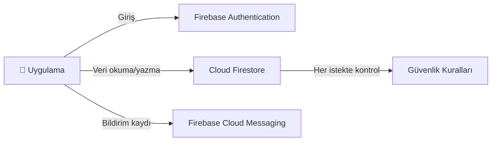
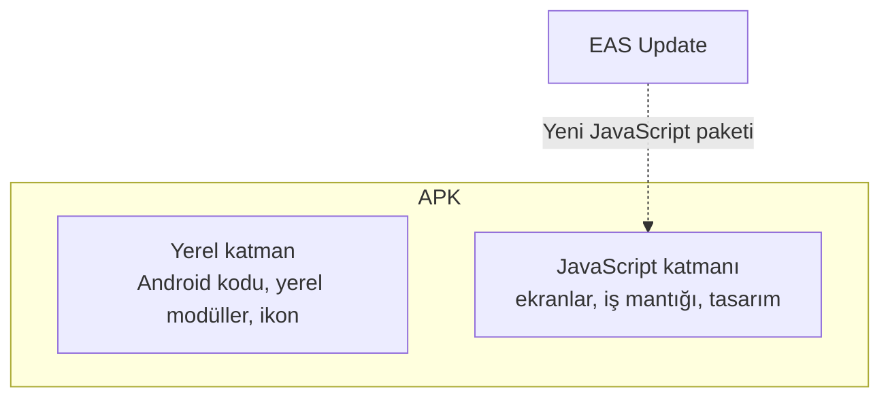
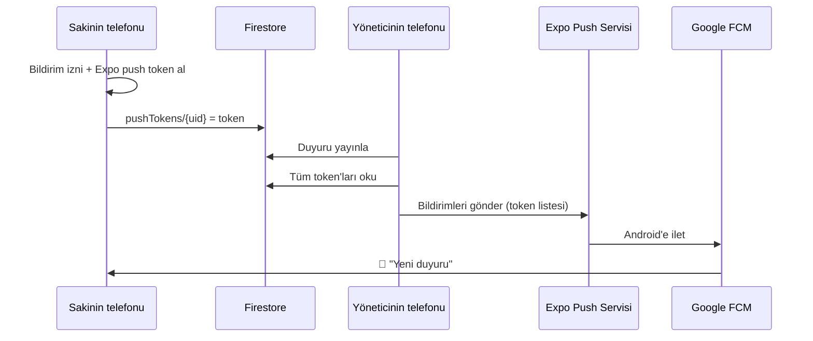
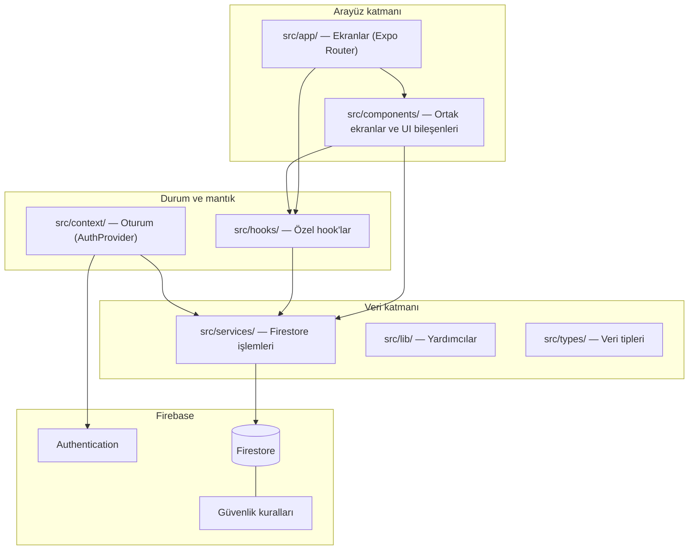
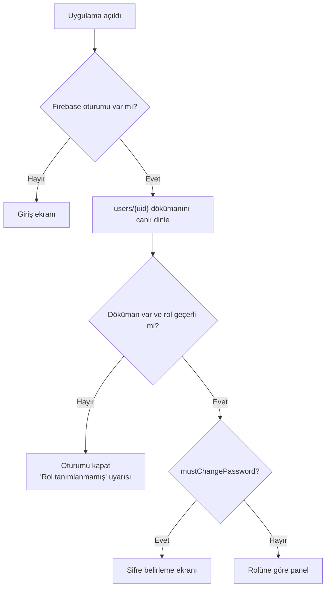
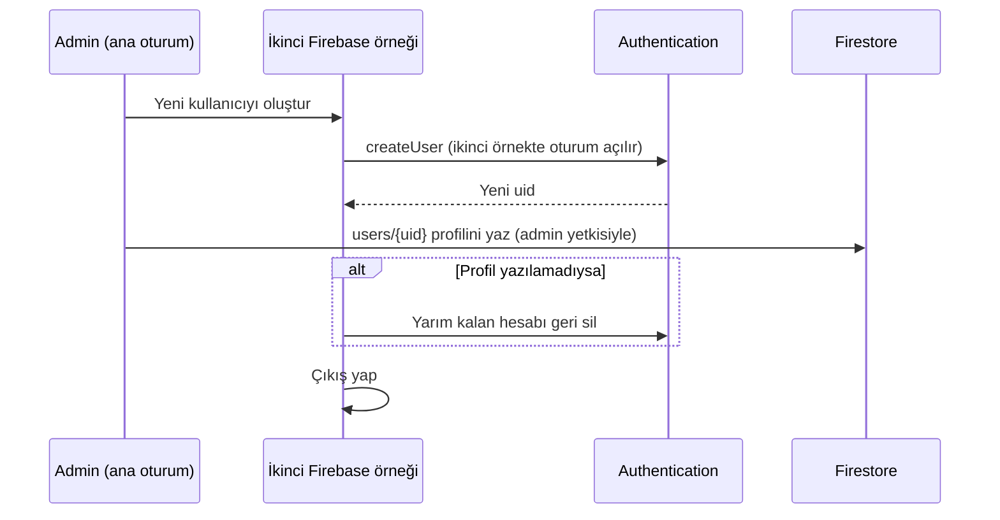
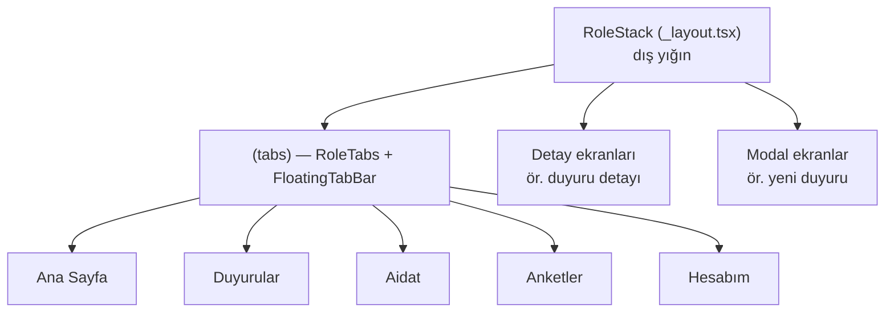
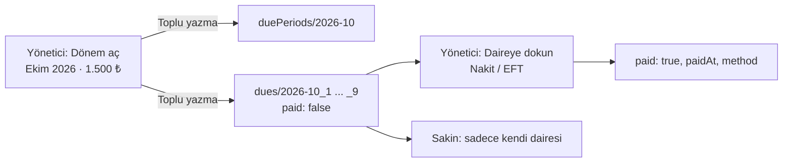
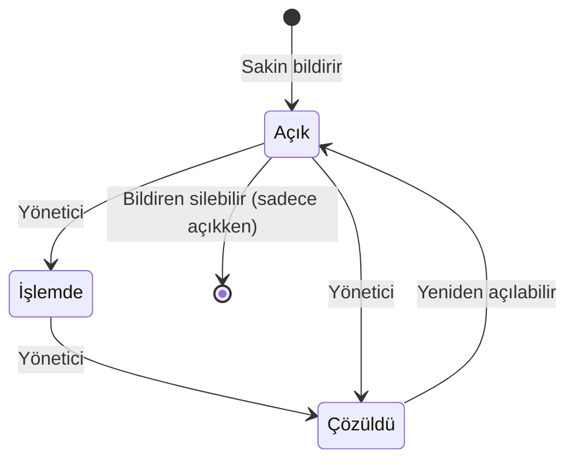
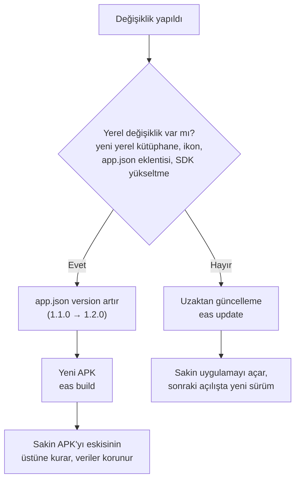

# Sürur Apartmanı Uygulaması · Teknik Dokümantasyon

> Bu doküman, Sürur Apartmanı yönetim uygulamasının **neden ve nasıl** yapıldığını anlatır. İlk bölümler kullanılan teknolojileri (React Native, Expo, Firebase, EAS) sıfırdan açıklar; sonraki bölümler uygulamanın mimarisini, veri modelini, güvenlik kurallarını ve her modülün çalışma mantığını ayrıntılı olarak ele alır.
>
> Hızlı kurulum ve özet için [README](../README.md) dosyasına bakın.

---

## İçindekiler

1. [Uygulamaya genel bakış](#1-uygulamaya-genel-bakış)
2. [Temel kavramlar ve teknolojiler](#2-temel-kavramlar-ve-teknolojiler)
   - 2.1 [Mobil uygulama geliştirme yaklaşımları](#21-mobil-uygulama-geliştirme-yaklaşımları)
   - 2.2 [React ve React Native](#22-react-ve-react-native)
   - 2.3 [TypeScript](#23-typescript)
   - 2.4 [Expo](#24-expo)
   - 2.5 [Expo Router](#25-expo-router)
   - 2.6 [Firebase](#26-firebase)
   - 2.7 [EAS (Expo Application Services)](#27-eas-expo-application-services)
   - 2.8 [Anlık bildirimler nasıl çalışır?](#28-anlık-bildirimler-nasıl-çalışır)
3. [Mimari](#3-mimari)
4. [Proje yapısı](#4-proje-yapısı)
5. [Kimlik doğrulama ve roller](#5-kimlik-doğrulama-ve-roller)
6. [Navigasyon yapısı](#6-navigasyon-yapısı)
7. [Veri modeli](#7-veri-modeli)
8. [Güvenlik kuralları](#8-güvenlik-kuralları)
9. [Modüller](#9-modüller)
10. [Arayüz sistemi](#10-arayüz-sistemi)
11. [Yardımcı kütüphaneler (`lib/`)](#11-yardımcı-kütüphaneler-lib)
12. [Geliştirme ortamı](#12-geliştirme-ortamı)
13. [Derleme, dağıtım ve güncelleme](#13-derleme-dağıtım-ve-güncelleme)
14. [Tasarım kararları ve bilinen sınırlamalar](#14-tasarım-kararları-ve-bilinen-sınırlamalar)
15. [Sorun giderme](#15-sorun-giderme)
16. [Sözlük](#16-sözlük)

---

## 1. Uygulamaya genel bakış

**Sürur Apartmanı uygulaması**, 9 daireli bir apartmanın yönetimini dijitalleştiren bir Android uygulamasıdır. Yönetici ile sakinler arasındaki iletişimi tek bir yerde toplar ve kayıt altına alır.

| Özellik | Değer |
|---|---|
| Platform | Android (APK olarak dağıtılır, mağazada değildir) |
| Kullanıcı sayısı | 9 daire ve aile üyeleri |
| Teknoloji | React Native, Expo SDK 57, TypeScript, Firebase |
| Maliyet | Tamamen ücretsiz (Firebase Spark planı, Expo ücretsiz planı) |
| Güncelleme | Kod değişiklikleri uygulama içine uzaktan gelir |

### Roller

| Rol | Kim | Yetkiler |
|---|---|---|
| **Admin** (`admin`) | Uygulamanın sahibi | Kullanıcı ekler ve siler, rol ve telefon atar |
| **Yönetici** (`manager`) | Apartman yöneticisi | Duyuru, aidat, gider, anket, rehber, ödeme bilgisi ve yıllık raporu yönetir; arıza taleplerini sonuçlandırır |
| **Sakin** (`resident`) | Daire sakinleri ve aile üyeleri | Bilgileri görüntüler, arıza bildirir, ankete oy verir |

### Modüller

Duyurular · Aidat takibi · Giderler · Yıllık rapor · Arıza ve istekler · Anketler · Önemli numaralar · Ödeme bilgileri (IBAN) · Kullanıcı yönetimi · Hesabım · Özet panolu ana sayfa · Anlık bildirimler

---

## 2. Temel kavramlar ve teknolojiler

Bu bölüm, uygulamanın üzerine kurulduğu teknolojileri hiç bilmeyen birinin de anlayabileceği şekilde açıklar.

### 2.1 Mobil uygulama geliştirme yaklaşımları

Bir mobil uygulama üç temel yolla geliştirilebilir:

| Yaklaşım | Nasıl? | Artı | Eksi |
|---|---|---|---|
| **Yerel (native)** | Android için Kotlin, iOS için Swift ile ayrı ayrı yazılır | En yüksek performans ve platform erişimi | İki ayrı kod tabanı, iki kat emek |
| **Web tabanlı (hibrit)** | Bir web sayfası, uygulama kabuğu içinde gösterilir | Tek kod, web bilgisiyle yapılır | Yavaş hisseder, gerçek uygulama gibi davranmaz |
| **Çapraz platform (cross-platform)** | Tek kod yazılır, her platformun **gerçek** arayüz bileşenlerine çevrilir | Tek kod tabanı, yerel arayüz, iyi performans | Bazı özel yerel özellikler için ek iş gerekebilir |

Bu uygulama **çapraz platform** yaklaşımıyla, **React Native** kullanılarak yazıldı. Kodun tamamı iOS'ta da çalışabilir; iOS'a dağıtılmamasının sebebi teknik değil, Apple'ın dağıtım kurallarıdır (bkz. [Bölüm 14](#14-tasarım-kararları-ve-bilinen-sınırlamalar)).

### 2.2 React ve React Native

**React**, Meta (Facebook) tarafından geliştirilen, arayüzleri **bileşenler (components)** halinde kurmaya yarayan bir JavaScript kütüphanesidir. **React Native** ise aynı yaklaşımı mobil uygulamalara taşır: yazdığınız bileşenler HTML'e değil, Android ve iOS'un gerçek arayüz öğelerine dönüştürülür.

#### Bileşen (component)

Arayüzün yeniden kullanılabilir bir parçasıdır. Bir fonksiyon olarak yazılır ve ekranda ne görüneceğini döndürür:

```tsx
function Selamlama({ isim }: { isim: string }) {
  return <Text>Merhaba, {isim}</Text>;
}

// Kullanımı:
<Selamlama isim="Ahmet" />
```

#### Props ve state

- **Props:** Bileşene dışarıdan verilen değerlerdir (yukarıdaki `isim` gibi). Bileşen bunları değiştiremez.
- **State (durum):** Bileşenin kendi içinde tuttuğu ve değişebilen veridir. State değişince React ekranı otomatik olarak yeniden çizer.

#### Hook'lar

React'te state ve yan etkiler **hook** adı verilen özel fonksiyonlarla yönetilir. Bu projede en çok kullanılanlar:

| Hook | Ne işe yarar? | Projede örnek |
|---|---|---|
| `useState` | Bileşene değişebilen bir değer ekler | Form alanları, yükleniyor durumları |
| `useEffect` | Ekran açılınca bir iş başlatır, kapanınca temizler | Firestore'u canlı dinlemeye başlamak ve bırakmak |
| `useMemo` | Pahalı bir hesabı, girdiler değişmedikçe tekrar yapmaz | Aidat özetleri, kategori toplamları |
| `useContext` | Uygulamanın her yerinden ortak bir veriye erişir | Oturum bilgisi (`useAuth`) |
| Özel hook'lar | Tekrar eden mantığı paketler | `useResidentSummary`, `usePushNotifications` |

Örnek: bir ekranın Firestore'daki duyuruları canlı izlemesi:

```tsx
const [duyurular, setDuyurular] = useState<Announcement[] | null>(null);

useEffect(() => {
  // Ekran açılınca dinlemeye başla; dönen fonksiyon ekran kapanınca dinlemeyi bırakır.
  return subscribeToAnnouncements(setDuyurular, () => setHata('Yüklenemedi'));
}, []);
```

#### React Native'e özgü bileşenler

Web'deki `<div>`, `<p>` yerine React Native'in kendi bileşenleri kullanılır:

| React Native | Karşılığı | Açıklama |
|---|---|---|
| `View` | `div` | Kutu, düzen için |
| `Text` | `p`, `span` | Her metin mutlaka `Text` içinde olmalı |
| `Pressable` | `button` | Dokunulabilir alan |
| `TextInput` | `input` | Metin girişi |
| `ScrollView` | kaydırılabilir alan | İçerik ekrandan uzunsa |

Stil, CSS'e benzeyen JavaScript nesneleriyle verilir (`StyleSheet.create`). Düzen için **Flexbox** kullanılır.

### 2.3 TypeScript

**TypeScript**, JavaScript'e **tip** ekleyen bir dildir. Kod çalışmadan önce, yazım sırasında hataları yakalar:

```ts
interface UserProfile {
  displayName: string;
  apartmentNo: number | null;   // Admin'in dairesi yoktur
  role: 'admin' | 'manager' | 'resident';
}

profile.role = 'yonetici';  // ❌ Hata: bu değer izin verilenler arasında değil
```

Bu projede bütün veri yapıları `src/types/` altında tip olarak tanımlıdır ve `npm run typecheck` komutu tüm projeyi kontrol eder.

### 2.4 Expo

**Expo**, React Native üzerine kurulu bir geliştirme platformudur. React Native'i tek başına kullanmak; Android Studio, Gradle, yerel yapılandırma dosyaları gibi pek çok ayrıntıyla uğraşmayı gerektirir. Expo bunları sizin yerinize yönetir.

#### Expo SDK

Expo, kamera, bildirim, yazı tipi, titreşim gibi telefon özelliklerine erişen hazır modüller sunar (`expo-notifications`, `expo-haptics`, `expo-clipboard`...). Bu modüller birlikte test edilmiş bir paket halinde, **SDK sürümü** olarak yayınlanır. Bu proje **SDK 57** kullanır. Paketler her zaman `npx expo install <paket>` ile kurulur; böylece SDK ile uyumlu sürüm seçilir.

#### Expo Go

Play Store'dan indirilen bir uygulamadır. Geliştirme sırasında bilgisayarda `npx expo start` çalıştırılır, ekrana gelen QR kod Expo Go ile okutulur ve uygulama anında telefonda açılır. Kod değiştikçe telefon kendiliğinden yenilenir.

Expo Go'nun bir sınırı vardır: sadece içinde **hazır bulunan** yerel modülleri çalıştırabilir. Örneğin Android'de uzaktan bildirim almayı desteklemez (bkz. [Bölüm 15](#15-sorun-giderme)).

#### Continuous Native Generation (CNG)

Bu projede `android/` ve `ios/` klasörleri **yoktur**. Expo bunları derleme sırasında `app.json` dosyasından otomatik üretir. Yerel bir ayar gerektiğinde (paket adı, ikon, bildirim ikonu...) bu ayar `app.json`'a ya da bir **config plugin**'e yazılır; yerel dosyalara elle dokunulmaz.

#### app.json

Uygulamanın kimlik kartıdır. Projede önemli alanlar:

| Alan | Değer | Anlamı |
|---|---|---|
| `name` | Sürur Apartmanı | Telefonda görünen ad |
| `version` | 1.1.0 | Kullanıcıya görünen sürüm; yerel değişiklikte artırılır |
| `android.package` | `com.ensarakbas.sururapartmani` | Android'deki kalıcı kimlik; **asla değiştirilmemeli** |
| `android.googleServicesFile` | `./google-services.json` | Bildirimler için Firebase Android yapılandırması |
| `runtimeVersion.policy` | `appVersion` | Uzaktan güncellemelerin hangi APK'lara gideceği |
| `updates.url` | `https://u.expo.dev/...` | Uzaktan güncelleme sunucusu |
| `plugins` | expo-router, splash, datetimepicker, notifications | Yerel ayar yapan eklentiler |

### 2.5 Expo Router

**Expo Router**, **dosya tabanlı yönlendirme** sağlar: `src/app/` klasöründeki her dosya bir ekrandır ve dosyanın yolu ekranın adresi olur.

| Dosya | Adres | Açıklama |
|---|---|---|
| `src/app/login.tsx` | `/login` | Basit ekran |
| `src/app/manager/(tabs)/dues.tsx` | `/manager/dues` | Parantezli klasör (grup) adrese yansımaz |
| `src/app/manager/dues/[periodId].tsx` | `/manager/dues/2026-10` | Köşeli parantez dinamik parametredir |
| `src/app/manager/_layout.tsx` | — | O klasördeki ekranları saran navigatör |

**`_layout.tsx`** dosyaları navigasyon türünü belirler: `Stack` (ekranlar üst üste açılır, geri gidilir) ya da `Tabs` (alttaki sekmeler).

**`Stack.Protected`** ile ekranlar bir koşula bağlanır. Koşul sağlanmazsa o ekrana gidilemez ve kullanıcı ana ekrana yönlendirilir. Bu projede rol bazlı erişimin arayüz tarafı böyle kurulmuştur (bkz. [Bölüm 5](#5-kimlik-doğrulama-ve-roller)).

**Typed routes** özelliği açıktır: `router.push('/manager/dues')` gibi adresler TypeScript tarafından kontrol edilir, yanlış yazılmış bir adres derleme hatası verir.

### 2.6 Firebase

**Firebase**, Google'ın sunduğu bir **Backend-as-a-Service (BaaS)** platformudur. Normalde bir uygulamanın arkasında sunucu, veritabanı ve kimlik doğrulama sistemi kurmak gerekir. Firebase bunları hazır hizmet olarak verir; uygulama doğrudan Firebase ile konuşur.



#### Firebase Authentication

Kullanıcı hesaplarını ve girişi yönetir. Bu projede **e-posta/şifre** yöntemi kullanılır. Sakinlerin gerçek bir e-postası olması gerekmez: kullanıcı adı arka planda sahte bir adrese çevrilir (bkz. [Bölüm 5](#5-kimlik-doğrulama-ve-roller)).

Oturum, telefonun hafızasında (AsyncStorage) saklanır; uygulama kapanıp açılınca tekrar giriş istenmez.

#### Cloud Firestore

**NoSQL**, belge tabanlı bir veritabanıdır. Tablolar ve satırlar yerine **koleksiyonlar** ve **dökümanlar** vardır:

```
announcements (koleksiyon)
 └─ abc123 (döküman)
     ├─ title: "Su kesintisi"
     ├─ body: "Yarın 10:00-12:00 arası..."
     ├─ important: true
     ├─ createdAt: 16 Ekim 2026 10:30
     └─ reads (alt koleksiyon)
         └─ <uid>: { apartmentNo: 5, readAt: ... }
```

Projede kullanılan Firestore özellikleri:

| Özellik | Ne işe yarar? | Projede |
|---|---|---|
| `onSnapshot` | Veriyi **canlı** dinler; veri değişince ekran anında güncellenir | Tüm listeler, ana sayfa özetleri |
| `serverTimestamp()` | Zamanı telefonun saatinden değil sunucudan alır | `createdAt`, `paidAt` gibi alanlar |
| `writeBatch` | Birden çok yazmayı **tek işlemde** yapar: ya hepsi olur ya hiçbiri | Aidat dönemi (1 dönem + 9 daire), anket oyu |
| `where` sorgusu | Filtreleme | Sakinin sadece kendi dairesinin aidatları |

**Not:** Birden fazla alana göre sıralama/filtreleme Firestore'da **birleşik dizin (composite index)** gerektirir. Bu projede dizin yönetmemek için sıralamalar telefonda yapılır.

#### Güvenlik Kuralları (Security Rules)

Uygulama Firestore ile doğrudan konuştuğu için, "kim neyi okuyup yazabilir" kararı **sunucu tarafında**, `firestore.rules` dosyasındaki kurallarla verilir. Arayüzde bir butonu gizlemek güvenlik değildir; asıl koruma bu kurallardır. Ayrıntılar [Bölüm 8](#8-güvenlik-kuralları)'de.

#### Spark (ücretsiz) planı

Proje Firebase'in ücretsiz **Spark** planında çalışır. Bu planda Authentication ve Firestore ücretsizdir (günlük okuma/yazma kotaları 9 daire için fazlasıyla yeterlidir). **Cloud Functions** (sunucu kodu) ve **Cloud Storage** (dosya depolama) ise ücretli plan gerektirdiği için kullanılmadı. Bu kısıtın tasarıma etkileri [Bölüm 14](#14-tasarım-kararları-ve-bilinen-sınırlamalar)'te anlatılıyor.

### 2.7 EAS (Expo Application Services)

**EAS**, Expo'nun bulut hizmetleridir. Bu projede iki tanesi kullanılır:

#### EAS Build

Uygulamayı Expo'nun sunucularında derleyip **APK** dosyası üretir. Bilgisayara Android Studio kurmak gerekmez. Yapılandırma `eas.json` dosyasındadır:

```json
{
  "build": {
    "production": {
      "distribution": "internal",
      "channel": "production",
      "environment": "production",
      "autoIncrement": true,
      "android": { "buildType": "apk" }
    }
  }
}
```

| Alan | Anlamı |
|---|---|
| `distribution: internal` | Mağaza değil, doğrudan dağıtım |
| `buildType: apk` | Doğrudan kurulabilir APK (mağaza için AAB yerine) |
| `channel: production` | Bu APK'nın uzaktan güncellemeleri hangi kanaldan alacağı |
| `environment: production` | Firebase ayarlarının hangi EAS ortamından alınacağı |
| `autoIncrement` | Her derlemede Android sürüm sayacını (versionCode) artırır |

#### EAS Update

**Uzaktan güncelleme (OTA, over-the-air)** sağlar. Bir React Native uygulaması iki katmandan oluşur:



Sadece JavaScript katmanını değiştiren güncellemeler (yeni ekran, hata düzeltmesi, tasarım) **APK'ya dokunmadan** gönderilebilir. Uygulama açılışta yeni paketi indirir, bir sonraki açılışta onu çalıştırır.

**Runtime version** kavramı, bir güncellemenin hangi APK'larla uyumlu olduğunu belirler. Bu projede `appVersion` politikası kullanılır: runtime version, `app.json`'daki `version` değeridir. Yani `1.1.0` için yayınlanan güncelleme sadece `1.1.0` APK'larına gider.

#### Kimlik bilgileri (credentials)

Android, her APK'nın bir **imza anahtarı (keystore)** ile imzalanmasını ister. Bir uygulamanın üstüne güncelleme kurulabilmesi için yeni APK'nın **aynı anahtarla** imzalanması şarttır. Bu projenin anahtarı ilk derlemede EAS tarafından üretildi ve Expo sunucularında saklanıyor; her derlemede otomatik olarak kullanılıyor.

### 2.8 Anlık bildirimler nasıl çalışır?



1. Uygulama APK'da açıldığında kullanıcıdan izin ister ve Expo'dan cihaza özel bir **push token** alır.
2. Token, Firestore'da `pushTokens/{uid}` dökümanına yazılır.
3. Bir olay olduğunda (ör. duyuru), olayı yapan kişinin uygulaması ilgili token'ları okur ve Expo'nun **ücretsiz push servisine** gönderir.
4. Expo, bildirimi Google'ın **Firebase Cloud Messaging (FCM)** altyapısı üzerinden telefona ulaştırır. Bunun için Expo'ya bir FCM servis hesabı anahtarı yüklenmiştir.

Bu yaklaşım sayesinde bildirim için ayrı bir sunucu gerekmez.

---

## 3. Mimari



### Katmanların görevleri

| Katman | Klasör | Sorumluluk |
|---|---|---|
| Ekranlar | `src/app/` | Sadece yönlendirme; çoğu dosya, ortak bir ekranı rolüne uygun ayarlarla çağıran birkaç satırdır |
| Ortak ekranlar | `src/components/` | Asıl ekran kodu; rol farkları prop'larla verilir |
| UI bileşenleri | `src/components/ui/` | Buton, kart, metin alanı gibi tasarım yapı taşları |
| Oturum | `src/context/` | Giriş durumu ve kullanıcı profili |
| Hook'lar | `src/hooks/` | Birden çok veri kaynağını birleştiren mantık (ana sayfa özeti vb.) |
| Servisler | `src/services/` | Her koleksiyon için okuma, yazma ve doğrulama |
| Yardımcılar | `src/lib/` | Para, tarih, telefon biçimlendirme gibi saf fonksiyonlar |
| Tipler | `src/types/` | Veri yapıları ve sabitler |

### Ortak ekran deseni

Aynı ekran, yönetici ve sakin için farklı yetkilerle kullanılır. Ekran bir kez yazılır, rol farkı prop ile verilir:

```tsx
// src/app/manager/(tabs)/announcements.tsx — yönetici: oluşturabilir
<AnnouncementsListScreen
  onOpen={(id) => router.push({ pathname: '/manager/announcements/[id]', params: { id } })}
  onCreate={() => router.push('/manager/announcements/compose')}
/>

// src/app/resident/(tabs)/announcements.tsx — sakin: sadece görüntüler
<AnnouncementsListScreen
  onOpen={(id) => router.push({ pathname: '/resident/announcements/[id]', params: { id } })}
/>
```

`onCreate` verilmezse "yeni duyuru" butonu görünmez. Adresler role özel dosyada yazıldığı için TypeScript bunları da kontrol eder.

### Servis deseni

Her servis dosyası aynı kalıbı izler:

```ts
// Canlı dinleme: değişince onChange çağrılır, dönen fonksiyon dinlemeyi bırakır.
export function subscribeToX(onChange: (items: X[]) => void, onError: (e: Error) => void) {
  return onSnapshot(collection(db, 'x'), (snap) => onChange(snap.docs.map(toX)), onError);
}

// Yazma: önce doğrula, kullanıcıya gösterilecek hatayı XError ile fırlat, sonra yaz.
export async function createX(input: XInput, author: UserProfile) {
  if (!input.title.trim()) throw new XError('Başlık girin.');
  await addDoc(collection(db, 'x'), { ...input, createdAt: serverTimestamp() });
}
```

Okumada `snapshot.data({ serverTimestamps: 'estimate' })` kullanılır; böylece yeni yazılmış ve sunucu saati henüz gelmemiş bir dökümanda tarih `null` yerine tahmini değer olur.

---

## 4. Proje yapısı

```
ApartmentManagement/
├── src/
│   ├── app/                     # Ekranlar (Expo Router)
│   │   ├── _layout.tsx          # Kök: oturum, yazı tipleri, rol koruması, bildirimler
│   │   ├── index.tsx            # Role göre yönlendirme
│   │   ├── login.tsx            # Giriş ekranı
│   │   ├── set-password.tsx     # İlk girişte zorunlu şifre belirleme
│   │   ├── admin/               # Admin: kullanıcı yönetimi
│   │   ├── manager/             # Yönetici ekranları
│   │   └── resident/            # Sakin ekranları
│   ├── components/
│   │   ├── ui/                  # Tasarım yapı taşları
│   │   ├── announcements/       # Duyuru ekranları
│   │   ├── dues/  expenses/  issues/  polls/
│   │   ├── home-screen.tsx      # Özet panolu ana sayfa
│   │   ├── floating-tab-bar.tsx # Yüzen sekme çubuğu
│   │   └── ...                  # Hesabım, rehber, rapor, IBAN kartı vb.
│   ├── config/firebase.ts       # Firebase bağlantısı
│   ├── constants/               # Tema, apartman adı ve daire sayısı
│   ├── context/auth-context.tsx # Oturum ve profil
│   ├── hooks/                   # Özel hook'lar
│   ├── lib/                     # Yardımcı fonksiyonlar
│   ├── services/                # Firestore işlemleri (koleksiyon başına)
│   └── types/                   # Veri tipleri
├── assets/images/               # İkonlar, açılış ekranı, bildirim ikonu
├── docs/                        # Bu dokümantasyon
├── firestore.rules              # Firestore güvenlik kuralları
├── app.json                     # Expo yapılandırması
├── eas.json                     # EAS derleme yapılandırması
├── google-services.json         # Firebase Android yapılandırması (bildirimler)
├── .env.example                 # Ortam değişkenleri şablonu
├── CLAUDE.md / AGENTS.md        # Yapay zekâ asistanları için proje notları
└── README.md
```

---

## 5. Kimlik doğrulama ve roller

### 5.1 Kullanıcı adıyla giriş

Firebase Authentication e-posta ister, ama sakinlerden e-posta istemek pratik değildir. Çözüm `src/lib/username.ts` dosyasındadır:

```ts
normalizeUsername('  Şükrü ')  // → "sukru"
usernameToEmail('Hüseyin')     // → "huseyin@apartman.local"
```

- Kullanıcı adı küçük harfe çevrilir, Türkçe karakterler sadeleştirilir (`ç→c, ğ→g, ı→i, ö→o, ş→s, ü→u`).
- `@apartman.local` gerçek bir alan adı değildir; bu adrese hiçbir zaman e-posta gönderilmez.
- Kullanıcı girişte "Hüseyin", "hüseyin" ya da "huseyin" yazsa da aynı hesaba girer.

### 5.2 Oturum ve profil (`AuthProvider`)

`src/context/auth-context.tsx` uygulamanın en üstünde çalışır ve şunları yapar:



- Profil dökümanı **canlı** dinlenir. Admin bir kullanıcının rolünü değiştirirse kullanıcı anında doğru panele geçer.
- Admin bir kullanıcıyı silerse (profil dökümanı silinir), kullanıcı o an uygulamadaysa oturumu kapatılır. "Kullanıcı silme" işlemi tam olarak bu mekanizmayla çalışır.
- `useAuth()` hook'u her ekrandan `profile`, `signIn`, `signOut` bilgilerine erişim sağlar.

### 5.3 Rol bazlı yönlendirme

`src/app/_layout.tsx`:

```tsx
<Stack.Protected guard={!profile}>
  <Stack.Screen name="login" />
</Stack.Protected>

<Stack.Protected guard={mustChangePassword}>
  <Stack.Screen name="set-password" />
</Stack.Protected>

<Stack.Protected guard={role === 'admin'}>   <Stack.Screen name="admin" />    </Stack.Protected>
<Stack.Protected guard={role === 'manager'}> <Stack.Screen name="manager" />  </Stack.Protected>
<Stack.Protected guard={role === 'resident'}><Stack.Screen name="resident" /> </Stack.Protected>
```

Koşulu sağlanmayan ekranlara gidilemez. `src/app/index.tsx` de giriş yapan kullanıcıyı rolüne uygun panele yönlendirir.

> ⚠️ Bu koruma **sadece arayüz içindir**. Kötü niyetli biri uygulamayı değiştirip Firestore'a doğrudan istek gönderse bile, [güvenlik kuralları](#8-güvenlik-kuralları) yetkisiz işlemi reddeder.

### 5.4 Admin'in kullanıcı oluşturması

Firebase'in istemci tarafındaki `createUserWithEmailAndPassword` fonksiyonu, yeni hesabı oluşturduğu anda **o hesapla oturum açar**. Admin bunu doğrudan kullansaydı kendi oturumu kapanırdı.

Çözüm (`src/services/users.ts`): **ikinci bir Firebase uygulama örneği**, sadece bellekte tutulan bir oturumla:



Yeni kullanıcı `mustChangePassword: true` ile işaretlenir.

### 5.5 İlk girişte zorunlu şifre değişikliği

- İşaretli kullanıcı giriş yapınca sadece `set-password` ekranını görebilir.
- Şifre değişimi için önce mevcut (geçici) şifreyle kimlik **yeniden doğrulanır** (`reauthenticateWithCredential`), sonra yeni şifre kaydedilir (`updatePassword`).
- Ardından profildeki işaret kaldırılır, kök yönlendirme kullanıcıyı ana sayfaya geçirir.
- Kurallar, kullanıcının bu işareti sadece **kaldırabilmesine** izin verir, tekrar koyamaz.

---

## 6. Navigasyon yapısı

Her rol klasörü iki katmanlı bir navigasyona sahiptir:



- **`RoleStack`** (`src/components/role-stack.tsx`): Sekmelerin üstüne açılan detay ve form ekranlarını barındırır. Başlık stilleri ve "Şifre değiştir" ekranı burada ortak tanımlıdır.
- **`RoleTabs`** (`src/components/role-tabs.tsx`): Sekme listesini alır, simge ve rozetleri ayarlar.
- **`FloatingTabBar`** (`src/components/floating-tab-bar.tsx`): Varsayılan sekme çubuğu yerine kullanılan, altta yüzen koyu "hap" şeklindeki çubuk. Rozet (ör. okunmamış duyuru sayısı) ve titreşim geri bildirimi içerir.

### Ekran haritası

| Rol | Sekmeler | Stack ekranları |
|---|---|---|
| Admin | Kullanıcılar, Hesabım | Yeni kullanıcı, kullanıcı detayı, şifre değiştir |
| Yönetici | Ana Sayfa, Duyurular, Aidatlar, Anketler, Hesabım | Duyuru yaz/detay, aidat dönemi aç/detay, anket aç/detay, arıza listesi/yeni/detay, gider listesi/ekle/detay, ödeme bilgileri, rehber/düzenle, yıllık rapor, şifre değiştir |
| Sakin | Ana Sayfa, Duyurular, Aidatlarım, Anketler, Hesabım | Duyuru detay, anket detay, arıza listesi/yeni/detay, gider listesi/detay, rehber, yıllık rapor, şifre değiştir |

Sekme çubuğu 5 sekmeyle dolu olduğu için arıza, gider, rehber ve rapor ekranlarına ana sayfadaki **hızlı erişim kutucuklarından** ulaşılır.

---

## 7. Veri modeli

Tüm koleksiyonlar ve kimlerin erişebildiği:

| Koleksiyon | İçerik | Okuyabilen | Yazabilen |
|---|---|---|---|
| `users/{uid}` | Profil | Kendisi, yönetici, admin | Admin; kişi kendi telefonunu ve şifre işaretini |
| `announcements/{id}` | Duyurular | Herkes¹ | Yönetici |
| `announcements/{id}/reads/{uid}` | Okunma kayıtları | Yönetici, admin | Kişinin kendisi |
| `duePeriods/{yyyy-mm}` | Aylık aidat dönemleri | Herkes | Yönetici |
| `dues/{yyyy-mm}_{daire}` | Daire bazlı aidat | Yönetici, admin, ilgili daire | Yönetici |
| `expenses/{id}` | Giderler | Herkes | Yönetici |
| `reports/{yıl}` | Yıllık özet | Herkes | Yönetici |
| `issues/{id}` | Arıza ve istekler | Herkes | Sakin oluşturur, yönetici günceller |
| `polls/{id}` | Anketler | Herkes | Yönetici; oy verirken daire sayacı |
| `polls/{id}/votes/{daire}` | Gizli oylar | Yönetici, admin, ilgili daire | Daire (tek oy) |
| `contacts/{id}` | Önemli numaralar | Herkes | Yönetici |
| `settings/apartment` | IBAN ve hesap bilgisi | Herkes | Yönetici |
| `pushTokens/{uid}` | Bildirim adresi | Yönetici/admin; sakin sadece yöneticilerinkini | Kişinin kendisi |

¹ "Herkes": profili olan, giriş yapmış kullanıcılar.

### Önemli dökümanların alanları

**`users/{uid}`**

| Alan | Tür | Açıklama |
|---|---|---|
| `username` | string | Normalleştirilmiş kullanıcı adı (`huseyin`) |
| `displayName` | string | Görünen ad (`Hüseyin Yılmaz`) |
| `role` | `admin` · `manager` · `resident` | Rol |
| `apartmentNo` | number · null | Daire (1-9); admin için `null` |
| `phone` | string | İsteğe bağlı; WhatsApp hatırlatmaları için |
| `mustChangePassword` | boolean | İlk girişte şifre değişikliği gerekli mi |
| `createdAt` | timestamp | Kayıt tarihi |

**`dues/{yyyy-mm}_{daire}`** (ör. `2026-10_5`)

| Alan | Tür | Açıklama |
|---|---|---|
| `periodId` | string | `2026-10` |
| `year`, `month` | number | Dönem |
| `apartmentNo` | number | Daire |
| `amount` | number | Tutar (₺) |
| `paid` | boolean | Ödendi mi |
| `paidAt` | timestamp · null | Ödeme tarihi |
| `method` | `cash` · `transfer` · null | Nakit / EFT |

Döküman kimliğinin `dönem_daire` biçiminde olması, aynı dönemde aynı daire için ikinci bir kayıt oluşmasını yapısal olarak engeller.

**`polls/{id}`**

| Alan | Tür | Açıklama |
|---|---|---|
| `question`, `description` | string | Soru ve açıklama |
| `options` | `[{ id, text }]` | 2-5 seçenek (`a`, `b`, `c`...) |
| `counts` | `{ a: 3, b: 5 }` | Seçenek başına oy sayısı |
| `votedApartments` | number[] | Oy kullanan daireler (kimin neye verdiği burada yok) |
| `closed` | boolean | Oylama kapandı mı |

---

## 8. Güvenlik kuralları

`firestore.rules`, uygulamanın **asıl yetkilendirme katmanıdır**. Her okuma ve yazma isteğinde Firebase sunucusu tarafından değerlendirilir.

### 8.1 Yardımcı fonksiyonlar

```
function me()           { return get(/databases/$(database)/documents/users/$(request.auth.uid)).data; }
function currentRole()  { return me().role; }
function isAdmin()      { return isSignedIn() && currentRole() == 'admin'; }
function isManager()    { return isSignedIn() && currentRole() == 'manager'; }
function hasProfile()   { return isSignedIn() && currentRole() in ['admin', 'manager', 'resident']; }
```

`me()`, isteği yapan kullanıcının profil dökümanını okur. Böylece her kural kullanıcının rolüne ve dairesine göre karar verebilir. `hasProfile()`, profili silinmiş ama oturumu açık kalmış kullanıcıların veri okumasını engeller.

### 8.2 Kurallarda kullanılan teknikler

| Teknik | Örnek | Ne sağlar? |
|---|---|---|
| Rol kontrolü | `allow create: if isManager()` | Sadece yönetici duyuru yayınlar |
| Daire kontrolü | `resource.data.apartmentNo == me().apartmentNo` | Sakin sadece kendi dairesinin aidatını okur |
| Alan beyaz listesi | `keys().hasOnly([...])` | İzin verilmeyen alan yazılamaz (ör. sakin `role` ekleyemez) |
| Değişen alan kısıtı | `diff(resource.data).affectedKeys().hasOnly(['phone'])` | Kişi profilinde sadece telefonunu değiştirebilir |
| Sunucu zamanı | `createdAt == request.time` | Tarih sahte gönderilemez |
| Kimlik eşleşmesi | `reporterUid == request.auth.uid` | Kimse başkası adına talep açamaz |
| Toplu işlem kontrolü | `getAfter(...)` | Anket oyu ile sayaç birbiriyle tutarlı olmak zorunda |

### 8.3 Örnek: anket oyunun korunması

Bir daire oy verirken iki yazma **aynı toplu işlemde** yapılır: oy kaydı (`votes/{daire}`) ve anketin sayacı. Kurallar:

- Oy kaydının kimliği kişinin **kendi dairesi** olmalı → başkası adına oy verilemez.
- Kayıt zaten varsa yazma reddedilir → **ikinci oy** verilemez, oy değiştirilemez.
- Ankette sadece **seçilen seçeneğin sayacı tam 1 artmalı**, daire numarası katılımcılara eklenmeli. Bu kontrol, işlem sonrasındaki durumu gösteren `getAfter()` ile yapılır.
- Anket kapalıysa oy verilemez.
- Sakin sadece **kendi dairesinin** oyunu okuyabilir → oylar gizli kalır.

### 8.4 Kuralların yayınlanması

Projede Firebase CLI kullanılmadığı için kurallar elle yayınlanır:

1. `firestore.rules` dosyasının tamamını kopyalayın.
2. Firebase Console → Firestore Database → **Rules** → yapıştırın → **Publish**.

> Yeni bir koleksiyon ya da alan yazan bir özellik eklendiğinde kurallar da güncellenip yayınlanmalıdır; aksi halde yazmalar "izin verilmedi" hatasıyla reddedilir.

---

## 9. Modüller

Her modül için: amaç, ilgili dosyalar, akış ve önemli kararlar.

### 9.1 Ana sayfa (özet panosu)

**Amaç:** Kullanıcıya bir bakışta neye dikkat etmesi gerektiğini göstermek.

**Dosyalar:** `components/home-screen.tsx`, `hooks/use-home-summary.ts`, `app/{manager,resident}/(tabs)/index.tsx`

**Bölümler:**
1. **Koyu üst panel:** Tarih, selamlama, apartman ve daire bilgisi; içinde kişiye özel özet.
   - Sakin: ödenmemiş aidat toplamı (kırmızı) ya da "Borcunuz yok" (yeşil).
   - Yönetici: bu ayın tahsilatı, ilerleme çubuğu, "6/9 daire ödedi".
2. **Sizi bekleyenler:** Dokununca ilgili ekrana götüren yapılacaklar listesi.
   - Sakin: oy bekleyen anketler, işlemdeki ya da yeni çözülen talepleri.
   - Yönetici: yeni arıza talepleri, ödemeyen daireler, açılmamış aidat dönemi, oy bekleyen anketler.
3. **Son duyuru** kartı.
4. **Hızlı erişim** kutucukları; her bölüm kendi renginde.

`useResidentSummary` ve `useManagerSummary`, aidat, anket ve talep verilerini canlı dinleyip özet haline getirir.

### 9.2 Duyurular

**Dosyalar:** `services/announcements.ts`, `components/announcements/*`, `hooks/use-unread-announcements.ts`, `lib/read-announcements.ts`

- Yönetici duyuru yazar, düzenler, siler; "Önemli" olarak işaretleyebilir.
- Yayınlanınca yönetici hariç herkese **bildirim** gider.
- **Okunmamış rozeti:** Sakinin sekme çubuğunda okunmamış duyuru sayısı, listede "Yeni" etiketi. Okunanlar **telefonda** (AsyncStorage) tutulur. Uygulama ilk kurulduğunda mevcut duyurular okunmuş sayılır, eski duyurular rozet almaz.
- **Okunma takibi:** Sakin duyuruyu açınca `reads/{uid}` kaydı yazılır. Yönetici detay ekranında "Okuyan daireler 7/9" bilgisini görür.

### 9.3 Aidat takibi

**Dosyalar:** `services/dues.ts`, `app/manager/(tabs)/dues.tsx`, `app/manager/dues/*`, `app/resident/(tabs)/dues.tsx`, `components/iban-card.tsx`



- **Dönem açma:** Tek toplu işlemle dönem dökümanı ve 9 dairenin "ödenmedi" kaydı oluşturulur; ya hepsi yazılır ya hiçbiri. Aynı ay iki kez açılamaz. Tüm sakinlere bildirim gider.
- **Ödeme işaretleme:** Yönetici daireye dokunup Nakit ya da EFT seçer; ödenmiş bir kayıt "ödenmedi" yapılabilir.
- **WhatsApp hatırlatması:** Ödemeyen dairenin yanındaki yeşil butonla, sakinin telefonuna hazır mesaj açılır (tutar ve IBAN dahil).
- **Sakin ekranı:** Toplam borç (kırmızı/yeşil), ay ay liste, IBAN kartı ve **Kopyala** butonu.
- **Tutar girişi:** Türkçe biçimler kabul edilir (`1500`, `1.500`, `1.500,50`); bkz. `lib/money.ts`.

### 9.4 Giderler ve kasa

**Dosyalar:** `services/expenses.ts`, `components/expenses/*`, `app/manager/expenses/*`

- Yönetici gider ekler: kategori, ad, tutar, tarih (telefonun takvimiyle), not.
- Herkes ay ay giderleri, aylık toplamı ve kategori dağılımını görür.
- Yönetici ayrıca **kasa bakiyesini** görür: bugüne kadar tahsil edilen aidatlar eksi tüm giderler.
- Tarih, saat dilimi kaymasıyla günün değişmemesi için o günün öğlen saatine sabitlenerek kaydedilir.

### 9.5 Yıllık rapor

**Dosyalar:** `services/reports.ts`, `components/report-screen.tsx`

Sakinler diğer dairelerin aidat kayıtlarını okuyamaz; bu yüzden yıllık toplamları sakinlerin cihazında hesaplamak mümkün değildir. Çözüm:

1. Yönetici ekranı tüm aidat ve giderlerden raporu **canlı** hesaplar (önizleme).
2. Yönetici **"Raporu sakinlerle paylaş"** der; rapor `reports/{yıl}` dökümanına yazılır.
3. Sakinler bu yayınlanmış özeti görür.

İçerik: toplam gelir ve gider, yıl sonu farkı, aidat tahsilat oranı, aylık gelir-gider çubuk grafiği, gider dağılımı. Grafik ek bir kütüphane olmadan, React Native `View`'ları ile çizilir.

### 9.6 Arıza ve istekler

**Dosyalar:** `services/issues.ts`, `components/issues/*`



- Kategoriler: Asansör, Elektrik/Aydınlatma, Su/Tesisat, Isınma/Doğalgaz, Temizlik, Ortak alan/Bahçe, Otopark/Garaj, Diğer.
- Talepler **herkese açıktır**: aynı arıza tekrar bildirilmez, tarihler kayıt altında kalır.
- Yeni talep → yöneticiye bildirim. Durum ya da not değişimi → talebi açan sakine bildirim.
- Talebin içeriği sonradan değiştirilemez; yönetici sadece durumu ve notu günceller.

### 9.7 Anketler

**Dosyalar:** `services/polls.ts`, `components/polls/*`

- Yönetici 2-5 seçenekli anket açar, kapatır, yeniden açar, siler.
- **Her daire tek oy** kullanır; oy değiştirilemez (bkz. [8.3](#83-örnek-anket-oyunun-korunması)).
- Sakin sonuçları **oy verdikten sonra** ya da anket kapanınca görür, böylece önceki oylardan etkilenmez.
- Katılım (hangi daireler oy verdi) herkese, daire bazlı oy dökümü sadece yöneticiye görünür.
- Yeni anket açılınca herkese bildirim gider.

### 9.8 Önemli numaralar ve ödeme bilgileri

**Dosyalar:** `services/contacts.ts`, `services/settings.ts`, `components/contacts-screen.tsx`, `components/iban-card.tsx`, `app/manager/payment-info.tsx`

- Rehber: yönetici, asansör firması, tesisatçı gibi kayıtlar; yeşil butona dokununca **arama** başlar.
- Ödeme bilgileri (`settings/apartment`): IBAN, hesap sahibi, banka. IBAN biçimi doğrulanır (`TR` + 24 rakam), boşluksuz saklanır, gruplanarak gösterilir.

### 9.9 Kullanıcı yönetimi (admin)

**Dosyalar:** `services/users.ts`, `app/admin/*`, `components/phone-editor.tsx`

- Kullanıcı ekleme: daire seçimi (dolu daireler işaretli), rol (Sakin/Yönetici), ad, kullanıcı adı, geçici şifre, isteğe bağlı telefon.
- Oluşturunca giriş bilgileri tek dokunuşla **WhatsApp**'tan gönderilebilir.
- Bir dairede birden fazla kişi olabilir (aile üyeleri). Aidat ve anket oyu daire bazlı olduğu için çift kayıt oluşmaz.
- Rol ve telefon değiştirme, kullanıcıyı silme.
- Admin kendisini ve diğer adminleri değiştiremez ya da silemez.

### 9.10 Hesabım

**Dosyalar:** `components/account-screen.tsx`, `components/change-password-screen.tsx`, `services/account.ts`

- Profil bilgileri, telefon güncelleme, şifre değiştirme, çıkış.
- Çıkış yapılırken o telefonun bildirim kaydı silinir.

### 9.11 Anlık bildirimler

**Dosyalar:** `services/push.ts`, `hooks/use-push-notifications.ts`

| Olay | Alıcı | Bildirim |
|---|---|---|
| Duyuru yayınlandı | Gönderen hariç herkes | "Yeni duyuru" / "Önemli duyuru" |
| Anket açıldı | Gönderen hariç herkes | "Yeni anket: oyunuzu kullanın" |
| Aidat dönemi açıldı | Gönderen hariç herkes | "Ekim 2026 aidatı" |
| Arıza talebi açıldı | Yöneticiler | "Yeni talep · Daire 5" |
| Talep durumu/notu değişti | Talebi açan sakin | "Talebiniz: İşlemde" |

Teknik ayrıntılar:
- `expo-notifications` **tembel yüklenir** (`getNotifications()`): Expo Go'da bu modül yüklenirken uygulama çöktüğü için sadece APK'da ve ilk ihtiyaç anında yüklenir.
- Bildirim gönderimi hiçbir zaman hata fırlatmaz; asıl işlem (ör. duyuru) zaten kaydedilmiştir.
- Bildirime dokununca, bildirimdeki hedef (`{ type: 'announcement', id }` gibi) alıcının **rolüne göre** doğru ekrana çevrilir.
- Expo tek istekte en fazla 100 bildirim kabul ettiği için gönderim 100'lük gruplara bölünür.

---

## 10. Arayüz sistemi

### 10.1 Tema (`src/constants/theme.ts`)

- **Renkler:** Açık ve koyu tema için ayrı paletler; telefonun ayarına göre otomatik seçilir (`useThemeColors()`). Ana renk indigo (`#534AB7`), üst panel koyu indigo (`#26215C`).
- **Bölüm renkleri (`tints`):** indigo (aidat), teal (arıza), coral (anket), pink (gider), blue (rehber), amber (rapor).
- **Ölçüler:** `spacing` (4-32), `radius` (10-28), `typography` (başlık, gövde, etiket).

### 10.2 Yazı tipi

Tüm uygulama **Plus Jakarta Sans** kullanır; yazı tipleri kök layout'ta yüklenir. Özel yazı tipleri her kalınlık için ayrı dosya olduğundan, `src/components/ui/text.tsx` içindeki `Text` bileşeni stildeki `fontWeight` değerini doğru yazı tipi dosyasına çevirir.

> React Native'in `Text`'i yerine her zaman `@/components/ui/text` kullanılmalıdır; aksi halde sistem yazı tipi görünür.

### 10.3 UI bileşenleri (`src/components/ui/`)

| Bileşen | Görev |
|---|---|
| `Screen` | Güvenli alan, arka plan, büyük başlık ve kaydırma |
| `Card` | Gölgeli, yuvarlak köşeli kutu |
| `Button` | Birincil / ikincil / tehlike türleri, yükleniyor durumu, titreşim |
| `IconButton` | Yuvarlak simge butonu (ör. "+") |
| `TextField` | Etiketli metin alanı; şifre göster/gizle, karakter sayacı, çok satır |
| `DateField` | Telefonun takvimiyle tarih seçimi |
| `SegmentedControl` | Seçenek düğmeleri (ör. Sakin/Yönetici) |
| `MonthSwitcher` | "‹ Ekim 2026 ›" ay seçici |
| `ProgressBar` | İlerleme çubuğu |
| `Notice` | Bilgi / uyarı / hata kutusu |
| `EmptyState` | Liste boşken açıklama ve eylem |
| `SkeletonList` | Yüklenirken yanıp sönen gri yer tutucular |
| `Avatar`, `RoleBadge` | Daire numaralı avatar, rol etiketi |

### 10.4 Etkileşim

- **Titreşim** (`lib/haptics.ts`): butonlarda hafif, sekme ve seçim değişiminde seçim, başarılı işlemde başarı titreşimi.
- **Animasyon:** Ana sayfa ve giriş ekranında bölümler `react-native-reanimated` ile kayarak belirir.
- **Yükleme:** Dönen simge yerine içerik biçiminde iskelet (`SkeletonList`).

---

## 11. Yardımcı kütüphaneler (`lib/`)

| Dosya | İçerik |
|---|---|
| `username.ts` | Kullanıcı adını normalleştirme ve e-postaya çevirme |
| `money.ts` | `formatMoney(1500.5)` → `1.500,50 ₺`; `parseMoney("1.500,50")` → `1500.5` |
| `date.ts` | "Bugün 14:30", "Dün", "12 Ekim" gibi göreli tarih biçimleri |
| `phone.ts` | Telefon normalleştirme ve biçimlendirme, arama, WhatsApp mesajı açma |
| `haptics.ts` | Titreşim yardımcıları (web'de sessizce devre dışı) |
| `auth-errors.ts` | Firebase giriş hatalarını Türkçe mesaja çevirme |
| `firestore-errors.ts` | Firestore hatalarını türüne göre (yetki / internet / oturum) Türkçe mesaja çevirme |
| `read-announcements.ts` | Okunan duyuruları telefonda saklayan küçük depo |

---

## 12. Geliştirme ortamı

### 12.1 Gereksinimler

- Node.js 20 veya üzeri
- Android telefonda Expo Go
- Bir Firebase projesi (Authentication: Email/Password açık; Firestore oluşturulmuş)

### 12.2 İlk kurulum

```bash
npm install
cp .env.example .env    # Firebase web uygulaması değerlerini doldurun
npx expo start          # QR kodu Expo Go ile okutun
```

`.env` içindeki `EXPO_PUBLIC_FIREBASE_*` değerleri derleme sırasında koda gömülür; bu yüzden `src/config/firebase.ts` içinde her biri `process.env.EXPO_PUBLIC_X` şeklinde tek tek okunur. Eksik değer varsa uygulama açılışta açıklayıcı bir hata verir.

İlk admin hesabının oluşturulması [README](../README.md) dosyasındaki "İlk admin hesabı" bölümünde anlatılmıştır.

### 12.3 Doğrulama

Projede otomatik test yoktur. Her değişiklikten sonra:

```bash
npm run typecheck                                   # TypeScript kontrolü
npx expo export --platform android --output-dir <geçici-klasör>   # Android paketinin derlendiğini doğrular
npx expo-doctor                                     # Yapılandırma ve bağımlılık kontrolü
```

### 12.4 Typed routes notu

`src/app/` altına yeni ekran eklendiğinde TypeScript yeni adresleri hemen tanımaz ve `Href` hatası verir. Çözüm: `.expo/types/router.d.ts` dosyasını silip `npx expo start` ile sunucuyu bir kez başlatmak; dosya yeniden üretilir.

---

## 13. Derleme, dağıtım ve güncelleme

### 13.1 İki tür güncelleme



#### Uzaktan güncelleme (çoğu değişiklik)

```bash
npx eas-cli@latest update --channel production --environment production --message "Açıklama"
```

#### Yeni APK

```bash
# 1. app.json → "version" artırılır
npx eas-cli@latest build --platform android --profile production
```

> ⚠️ **Sürüm kuralı:** Yerel kod değiştiği halde `version` artırılmazsa, yeni JavaScript uyumsuz eski APK'lara gider ve uygulama çökebilir. Bu yüzden yerel değişiklikte sürüm mutlaka artırılır.

### 13.2 Ortam değişkenleri

`.env` dosyası git'e eklenmediği için EAS'in bulut derlemesine de gitmez. Firebase değerleri bu yüzden EAS'in **production** ortamında tutulur ve derleme ile güncelleme sırasında oradan alınır.

### 13.3 Dağıtım

- APK, sakinlere WhatsApp üzerinden **belge** olarak ya da bir indirme linkiyle gönderilir.
- Android, mağaza dışı kurulumda "bilinmeyen kaynak" ve Play Protect uyarıları gösterir; bunlar normaldir.
- EAS'teki derleme dosyaları sınırlı süre saklanır (bu projede 13 gün gösterildi); APK'nın bir kopyası saklanmalıdır.

### 13.4 İmza anahtarı

Anahtar Expo sunucusunda saklanır ve her derlemede otomatik kullanılır. Kaybolursa mevcut kurulumlara güncelleme APK'sı kurulamaz. Expo hesabının güvenliği (güçlü şifre, iki adımlı doğrulama) bu yüzden önemlidir.

### 13.5 Bildirim kimlik bilgileri

| Dosya | Nerede | Gizli mi? |
|---|---|---|
| `google-services.json` | Repoda | Hayır; içindeki değerler APK'da da bulunur. Android API anahtarı Google Cloud'da sadece **FCM Registration API** ve **Firebase Installations API** ile kısıtlanmıştır |
| FCM servis hesabı anahtarı | Sadece Expo'da (Credentials) | **Evet**; repoya girmemesi için `.gitignore`'da koruma kuralı var |

### 13.6 Sürüm geçmişi

| Sürüm | İçerik |
|---|---|
| 1.0.0 | İlk APK: tüm modüller, uzaktan güncelleme altyapısı |
| 1.1.0 | Anlık bildirimler (yeni yerel modül: `expo-notifications`) |

---

## 14. Tasarım kararları ve bilinen sınırlamalar

Uygulamanın tamamen ücretsiz kalması hedeflendi. Bu, bazı bilinçli tercihlere yol açtı:

| Konu | Karar / Sınırlama | Sebep |
|---|---|---|
| Fotoğraf yükleme | Yok | Firebase Storage ücretli planda; uygulama boyutunu da küçük tutmak istendi |
| Sunucu kodu | Yok, her şey istemcide ve kurallarda | Cloud Functions ücretli planda |
| Şifre sıfırlama | Admin uygulamadan şifre sıfırlayamaz | Başkasının şifresini değiştirmek sunucu yetkisi ister. Gerekirse hesap silinip yeniden açılır |
| Hesap silme | Uygulama sadece profili siler, giriş hesabı Firebase'de kalır | Aynı sebep. Kullanıcı adını yeniden kullanmak için Firebase Console'dan da silinir |
| Açık kayıt | Firebase'de e-posta ile kayıt açık | Admin'in kullanıcı oluşturması buna dayanıyor. Profili olmayan hesaplar hiçbir veriye erişemez |
| Yıllık rapor | Yönetici yayınlar | Sakinler diğer dairelerin aidatını okuyamaz |
| Sıralama | Telefonda yapılır | Firestore birleşik dizinlerini yönetmemek için |
| Grafikler | Kütüphanesiz, `View` ile | Uygulama boyutu |
| iOS | Dağıtılmıyor | Kod uyumlu; ancak Apple, mağaza dışı kurulum için yıllık ücretli geliştirici hesabı istiyor |
| Bildirimler | Hesap başına tek cihaz | `pushTokens/{uid}` tek token tutar; aile üyelerine ayrı hesap açılması önerilir |
| Okunmamış rozeti | Cihaz bazlı | Okunanlar telefonda tutulur; başka telefonda yeniden "yeni" görünebilir |
| CI/CD | Otomatik yayın yok | Denenmemiş kodun sakinlere gitmemesi için yayınlar elle yapılır |

---

## 15. Sorun giderme

Geliştirme sırasında karşılaşılan gerçek sorunlar ve çözümleri:

| Belirti | Sebep | Çözüm |
|---|---|---|
| "Kullanıcı kaydedilemedi" / "izin verilmedi" | Firebase'de yayındaki kurallar eski, yeni alanı tanımıyor | `firestore.rules`'u Console'a yapıştırıp yayınlayın |
| Silinen kullanıcı adı tekrar kullanılamıyor | Giriş hesabı Firebase'de duruyor | Authentication → Users'tan hesabı silin |
| Expo Go'da `Cannot find native module 'ExpoTopicSubscriptionModule'` | `expo-notifications` Expo Go'da yüklenemiyor | Modül tembel yükleniyor (`getNotifications()`); doğrudan import etmeyin |
| Expo Go'da bildirim gelmiyor | Expo Go Android'de uzaktan bildirim desteklemiyor | Bildirimleri APK'da test edin |
| Bildirim bir aile üyesine gelmiyor | Aynı hesap birden fazla telefonda; son giriş yapan alıyor | Her kişiye ayrı hesap açın |
| EAS derlemesi "Runtime version mismatch" hatası | `fingerprint` politikası Windows ve Linux'ta farklı sonuç verdi | `appVersion` politikasına geçildi |
| TypeScript'te `Href` hataları | Rota tipleri eski | `.expo/types/router.d.ts` silinip sunucu yeniden başlatılır |
| GitHub "Public leak: Google API Key" uyarısı | `google-services.json` repoda | Anahtar Google Cloud'da FCM API'leriyle kısıtlandı; uyarı "Won't fix" olarak kapatılabilir |
| Geliştirme sunucusunda `Can't perform a React state update on a component that hasn't mounted yet` | Expo Router'ın iç uyarısı | Uygulamayı etkilemez, sadece geliştirme modunda görünür |
| Play Protect "güvenli olmayan uygulama" uyarısı | Uygulama mağazada değil | "Yine de yükle" ile kurulur |

---

## 16. Sözlük

| Terim | Açıklama |
|---|---|
| **APK** | Android uygulama paketi; doğrudan kurulabilir dosya |
| **AsyncStorage** | Telefonda anahtar-değer verisi saklayan basit depo |
| **BaaS** | Backend-as-a-Service; hazır sunucu hizmetleri (Firebase gibi) |
| **Bileşen (component)** | Arayüzün yeniden kullanılabilir parçası |
| **CNG** | Continuous Native Generation; yerel klasörlerin `app.json`'dan üretilmesi |
| **Config plugin** | `app.json` üzerinden yerel ayar yapan Expo eklentisi |
| **Döküman / koleksiyon** | Firestore'da kayıt / kayıtlar kümesi |
| **EAS** | Expo Application Services; bulut derleme ve güncelleme |
| **Expo Go** | Geliştirme sırasında uygulamayı anında çalıştıran Expo uygulaması |
| **FCM** | Firebase Cloud Messaging; Google'ın bildirim altyapısı |
| **Hook** | React'te state ve yan etkileri yöneten fonksiyon (`useState`, `useEffect`...) |
| **Keystore** | APK'ları imzalayan anahtar dosyası |
| **OTA** | Over-the-air; mağaza ya da APK olmadan uzaktan güncelleme |
| **Props** | Bileşene dışarıdan verilen değerler |
| **Push token** | Bir cihaza bildirim gönderebilmek için kullanılan adres |
| **Runtime version** | Uzaktan güncellemenin hangi APK'larla uyumlu olduğunu belirleyen değer |
| **Security Rules** | Firestore'da kimin neyi okuyup yazabileceğini belirleyen sunucu kuralları |
| **Spark planı** | Firebase'in ücretsiz planı |
| **State** | Bileşenin değişebilen iç verisi |
| **Toplu yazma (batch)** | Birden çok yazmanın tek işlemde, ya hep ya hiç yapılması |
| **Typed routes** | Uygulama içi adreslerin TypeScript ile kontrol edilmesi |
| **versionCode** | Android'in her APK'da artmasını beklediği iç sürüm sayacı |
